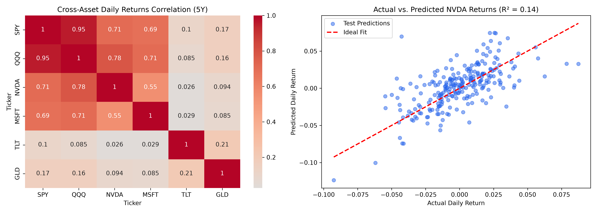

# Quantitative Equity Factor & Regression Analysis

A statistical and machine learning exploration of cross-asset market correlations, systematic risk (CAPM Beta), and multi-factor return modeling using Python.



## Project Overview
Financial time series exhibit complex interdependencies across asset classes. This project applies exploratory data analysis (EDA), statistical hypothesis testing, and supervised regression models to 5 years of historical daily market data (`SPY`, `QQQ`, `NVDA`, `MSFT`, `TLT`, `GLD`).

Key objectives:
* **Data Wrangling & Feature Engineering:** Computing daily percentage returns, 20-day rolling volatility, and 10-day momentum indicators while maintaining strict chronological integrity.
* **Correlation & Statistical Significance:** Evaluating Pearson correlation coefficients and *p-values* across equities, bonds, and commodities.
* **Time-Series Safe Modeling:** Implementing chronological train/test splits (80/20) to prevent look-ahead bias.
* **Predictive Regression Models:** Comparing Simple Linear Regression (CAPM Beta), Multiple Linear Regression (Multi-Factor), and Regularized Polynomial Ridge Regression.

## Tech Stack
* **Language:** Python 3
* **Data Manipulation & Math:** `pandas`, `numpy`, `scipy`
* **Machine Learning:** `scikit-learn` (`LinearRegression`, `Ridge`, `PolynomialFeatures`, `StandardScaler`, `Pipeline`)
* **Data Source & Visualization:** `yfinance`, `matplotlib`, `seaborn`

## Methodology & Models Evaluated
1. **Simple Linear Regression (CAPM Benchmark):** Estimates the target stock's market sensitivity ($\beta$) and excess return ($\alpha$) relative to the S&P 500 (`SPY`).
2. **Multiple Linear Regression:** Models daily asset returns using cross-asset signals (Tech sector `QQQ`, Long-Term Treasuries `TLT`, Gold `GLD`) alongside market volatility and momentum.
3. **Polynomial Ridge Regression (L2 Regularization):** Captures non-linear interaction terms (degree 2) between market factors while penalizing overfitting via Ridge regularization.

## How to Run
1. Clone the repository:
   ```bash
   git clone https://github.com/georgeionitza/financial-market-regression-analysis
   ```
2. Install dependencies:
   ```bash
   pip install numpy pandas yfinance scipy matplotlib seaborn scikit-learn
   ```
3. Open and run `Market_Factor_Regression_Analysis.ipynb` in Jupyter Notebook or JupyterLab.
